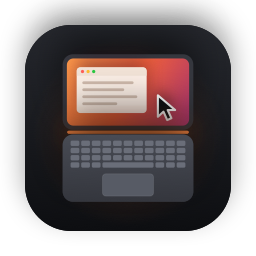

<p align="center"></p>

# Clamshell

Use your Mac from your iPhone, as if the phone were a small MacBook. Clamshell streams the Mac's screen to
the phone and turns the rest of the phone into a MacBook-style keyboard and trackpad. On an **iPhone Duo**
(the foldable) it follows how you hold it: half open like a laptop, sideways like a book, fully open as one
big screen. On any other iPhone, portrait is the laptop layout and landscape is one big screen.

It runs entirely on hardware you own. The Mac is the server, there is no account, no cloud service and no relay,
and everything between the phone and the Mac is end-to-end encrypted (Noise IKpsk2, ChaCha20-Poly1305).

- **Sharp, fast picture.** HEVC at up to 120 Hz, 1:1 pixels on the LAN, and a lighter stream away from home that
  adapts to the connection, with a text-sharpening refinement pass once the screen is still.
- **A real keyboard and trackpad.** MacBook ANSI layout with media keys, fn layer and sticky modifiers.
  Trackpad gestures (tap to click, two-finger scroll and right-click, hold to drag, three- and four-finger
  swipes for Spaces, Mission Control and the app switcher) arrive as real macOS trackpad events. The picture itself is a trackpad too, and pinch zooms the phone's view.
- **Any keyboard layout.** The phone's keys show what the Mac's current input source types (Arabic, English…)
  and 🌐 switches it.
- **Postures.** Laptop, book (split keyboard around the fold), flat and cover, with adjustable key and
  trackpad sizes.
- **Extras.** Mac sound on the phone, clipboard both ways, sending files to the Mac's Downloads, a stats HUD,
  keep-awake and open-at-login on the Mac.
- **Away from home.** UDP and a TLS-on-443 fallback raced in parallel, through your own router: the Mac
  opens the port forwards itself (UPnP) and keeps a free DuckDNS name pointed at your home, so the phone
  finds it again after the address changes or the router restarts. Pairing only ever happens on your home
  network.
- **Safe at the Mac.** Using the Mac's own keyboard or trackpad pauses the phone, pressing Esc three times
  ends every session, and phones can be revoked from the menu.

## Requirements

| | |
|---|---|
| Mac | macOS 26 or later; Apple silicon recommended (tested on a MacBook Pro M5, macOS 27.2) |
| iPhone | iOS 26 or later; an iPhone Duo for the posture layouts (tested on an iPhone Duo) |
| Build tools | Xcode 27.1 or later (tested with 27.2), [Homebrew](https://brew.sh) and `xcodegen` |
| Apple account | A free Apple Account is enough to build for your own devices (the phone app then needs a rebuild every 7 days). A paid Developer Program membership makes it a year. |

The main way in is to build both apps yourself, signed with your own Apple account. It takes one script.

**Don't want to build?** Each [release](https://github.com/Ibrahimogod/Clamshell/releases) also has an
unsigned `Clamshell.ipa` to install with AltStore or SideStore (signed with your own free Apple Account,
refreshed every 7 days) and an ad-hoc-signed, un-notarized `ClamshellHost.zip` for the Mac. No paid Apple
membership is involved, so there are trade-offs: see
[Install without building](docs/SETUP.md#install-without-building).

## Quick start

```bash
brew install xcodegen
git clone <this repository> Clamshell && cd Clamshell
tools/scripts/configure.sh      # finds your Apple team, writes mac-host/Config/Local.xcconfig
tools/scripts/release.sh        # builds both apps, installs the host in /Applications and the app on your phone
```

Before the first build: sign in to Xcode › Settings › Accounts, turn on Developer Mode on the phone, and
connect it with a cable once. Then grant the Mac host Screen Recording and Accessibility, pair the phone from
the host's menu, and connect. **[docs/SETUP.md](docs/SETUP.md)** walks through every step from a fresh Mac,
including reaching the Mac away from home.

## Recommended setup

Once the apps are installed, this is the setup that works best day to day. Each step is explained in
[docs/SETUP.md](docs/SETUP.md) (§ numbers below).

**On the Mac** (the host's menu-bar menu):
- Grant **Screen Recording** and **Accessibility** (Device Control on macOS 27), then quit and reopen the
  host (§4).
- Turn on **Open at login**, **Keep this Mac awake while plugged in**, and allow notifications (§4).
- Fix the UDP port at **443**, then quit and reopen the host (§6). Mobile networks pass 443; some drop
  other ports, such as WireGuard's 51820:
  ```bash
  defaults write <your prefix>.host udpPort -int 443
  ```

**On the router** (§6):
- Turn **UPnP on**. The Mac then opens UDP 443 and TCP 443 itself, and opens them again within a minute
  of a router restart.
- Keep the router's own **remote management off**, and delete any port forwards for 443 you made by
  hand (they win over the Mac's).
- Put the phone and the Mac on the same Wi-Fi, not a guest network, with no client (AP) isolation, so they
  find each other at home.
- If the router's public address is in 100.64–100.127, your ISP uses carrier-grade NAT and away from home
  can't work.

**For away from home** (§6):
- Make a free [DuckDNS](https://www.duckdns.org) name and save it with its token in **Home address…** on
  the Mac. Phones then dial the name, which the Mac keeps pointed at your current address.
- After pairing, or after changing the Mac's port, connect once at home so the phone learns the name and
  the port.
- On the phone, **Check connection** tests the home Wi-Fi, UDP and TCP paths one by one.
- After a router restart, give it about two minutes (the router coming back online, the Mac reopening the
  forwards, DuckDNS pointing at the new address), then connect.

**On the phone:**
- Allow **Local Network** (the app finds the Mac with Bonjour) (§5).
- With a free Apple Account, run `tools/scripts/release.sh` again before the 7-day profile runs out (§7).
- Optional: **Touch ID before connecting**, and the Mac's **Hide this Mac's screen during a
  session** (on by default away from home) ([USAGE.md](docs/USAGE.md)).

## Documentation

| | |
|---|---|
| [docs/SETUP.md](docs/SETUP.md) | Build, install, permissions, pairing, away from home, updating, troubleshooting |
| [docs/USAGE.md](docs/USAGE.md) | Everyday use: postures, keyboard and trackpad, settings, the Mac menu |
| [docs/DEVELOPMENT.md](docs/DEVELOPMENT.md) | Working on the code: projects, tests, debug switches, scripted runs, bench harnesses |
| [docs/security.md](docs/security.md) | Threat model and cryptographic design |
| [docs/architecture.md](docs/architecture.md), [docs/protocol.md](docs/protocol.md), [docs/video.md](docs/video.md), [docs/ux.md](docs/ux.md) | Design |
| [docs/adr/](docs/adr/README.md) | Architecture decision records |
| [CHANGELOG.md](CHANGELOG.md) | What changed in each version |

## Repository layout

| Folder | What |
|---|---|
| `shared/` | `ClamshellKit` Swift package: wire protocol, Noise sessions, transports, video pipelines, rate control, input model. Most of the tests live here. |
| `mac-host/` | The menu-bar host app for macOS (not sandboxed: it needs a virtual display, screen capture and input injection) |
| `ios-client/` | The iPhone app |
| `tools/` | `clamshell-probe`, `clamshell-bench`, `clamshell-netsim`, and `scripts/` (configure, release, icons, network rehearsal) |
| `docs/` | Setup, usage, design docs and ADRs |
| `research/` | Background research behind the design |

The Xcode projects are generated from each app's `project.yml` (`xcodegen generate`), so they aren't in git.

## Privacy

Nothing leaves your devices except the encrypted stream between your phone and your Mac. The apps collect no
data, contain no analytics and talk to no server of ours. If you set up a DuckDNS name, the Mac tells DuckDNS
your home's public address, and nothing else. See [docs/security.md](docs/security.md) and
[docs/app-store.md](docs/app-store.md).

## License

[MIT](LICENSE).
